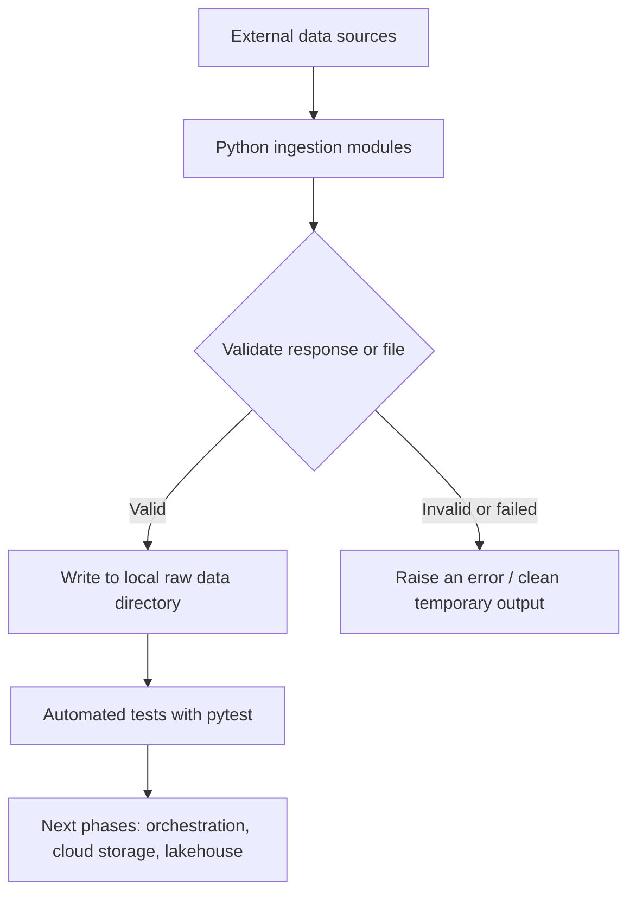
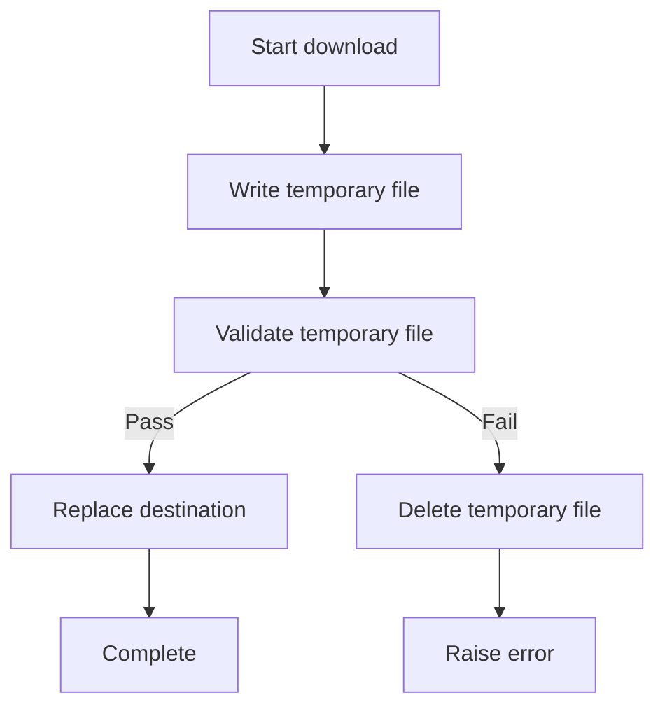

# UrbanMove Phase 1 Handover — Python Ingestion Foundation

> **Purpose:** Use this document in a separate teaching chat to learn Phase 1 properly before starting Phase 2.
>
> **Project:** UrbanMove — NYC transportation and city-service data engineering portfolio project.
>
> **Status note:** This handover reflects the implementation and test results recorded during Phase 1. It does not claim that AWS S3, Databricks, or a production Airflow ingestion pipeline has been implemented.

---

## 1. Phase 1 goals

Phase 1 establishes the Python ingestion foundation. The goal is not just to download files; it is to build reusable ingestion code that validates inputs, handles common failures, avoids publishing incomplete outputs, and can be tested without relying on live network calls.

By the end of this phase, the project has ingestion modules for:
- NYC taxi zone lookup CSV
- Open-Meteo historical weather data
- NYC 311 service requests API
- NYC Yellow Taxi monthly Parquet data

Repository structure:

```text
src/urbanmove/ingestion/
tests/
scripts/
README.md
requirements.txt
pytest.ini
airflow/dags/urbanmove_first_dag.py
```

## 2. Big-picture architecture



**Important:** In Phase 1, raw data is stored locally. AWS S3 integration and Databricks lakehouse processing are future work. The Airflow DAG currently in the repository is a demonstration DAG, not the complete ingestion workflow.

### Everyday analogy

Think of ingestion as receiving a delivery at a warehouse:

1. **Download/request:** The delivery truck arrives.
2. **Validate:** Check that the package contains the expected items and is not empty.
3. **Temporary file:** Put the delivery in a receiving area while checking it.
4. **Publish/replace:** Move it into official storage only after it passes checks.
5. **Tests:** Rehearse normal deliveries and failure scenarios so the process is predictable.

## 3. Data sources and current modules

### 3.1 Taxi zones — `src/urbanmove/ingestion/taxi_zones.py`

- Downloads the taxi zone lookup CSV.
- Checks required columns: `LocationID`, `Borough`, `Zone`, and `service_zone`.
- Checks that `LocationID` is not null and is unique.
- Uses a temporary file and replacement pattern.
- The inspected lookup had 265 rows and no duplicate rows. Missing descriptive fields: `Borough` 1, `Zone` 1, and `service_zone` 2; `LocationID` had no missing values.

### 3.2 Weather — `src/urbanmove/ingestion/weather.py`

- Calls the Open-Meteo historical/archive API.
- Requires `time`, `temperature_2m`, `precipitation`, `rain`, and `wind_speed_10m`.
- Validates date format and start date not after end date.
- Checks that the response is hourly, non-empty, has the required schema, and has no null or duplicate timestamps.
- Saves output through a temporary file and reuses valid existing output.
- The inspected January 1–2, 2025 sample had 48 records, no missing values, and no duplicate timestamps.
- Tests cover invalid dates, reversed date ranges, schema, duplicates, empty data, timeout, and HTTP errors.

### 3.3 NYC 311 — `src/urbanmove/ingestion/nyc_311.py`

- Calls the NYC Open Data API.
- Requires `unique_key`, `created_date`, `complaint_type`, `descriptor`, `borough`, `incident_zip`, and `status`.
- Uses pagination with a page size of 1,000, offsets, and ordering by `unique_key`.
- Validates date range, JSON response shape, required fields, non-empty output, and unique/non-null keys.
- Uses a temporary CSV and replaces the destination only after successful processing.
- The inspected January 1–2, 2025 sample had 10,873 rows and no duplicate keys. Missing values included 350 `descriptor` values and 50 `incident_zip` values; the other selected columns had no missing values.
- Tests cover schema, duplicate and missing keys, empty output, multiple pages, HTTP errors, invalid dates, and no records.

### 3.4 Yellow Taxi trips — `src/urbanmove/ingestion/taxi_trips.py`

- Downloads a monthly NYC TLC Yellow Taxi Parquet file.
- Validates requested year and month before downloading.
- Requires:
  - `tpep_pickup_datetime`
  - `tpep_dropoff_datetime`
  - `PULocationID`
  - `DOLocationID`
  - `trip_distance`
  - `fare_amount`
  - `total_amount`
- Checks that the Parquet file is non-empty, includes required columns, and can be read in batches.
- Compares readable row count with the Parquet metadata row count.
- Reuses an existing file if it passes validation.
- Downloads to a temporary path and replaces the destination only after validation. A failed replacement attempt preserves the previous destination.
- Uses PyArrow for Parquet reading/validation; `pyarrow` is listed in `requirements.txt`.

### 3.5 Taxi-trip inspection script — `scripts/inspect_taxi_data.py`

The January 2025 monthly Parquet file was about 57 MB and contained 3,475,226 rows and 20 columns.

| Check | Observed result |
|---|---:|
| Rows | 3,475,226 |
| Columns | 20 |
| Exact duplicate rows | 0 |
| Zero or negative trip distances | 90,893 |
| Negative fares | 144,118 |
| Negative total amounts | 63,037 |
| Drop-off before pickup | 124 |
| Maximum trip distance | 276,423.6 |

Missing values were reported for `passenger_count`, `RatecodeID`, `store_and_fwd_flag`, `congestion_surcharge`, and `Airport_fee`: 540,149 in each column. Do not assume these missing values overlap on exactly the same rows without checking.

The observed pickup timestamp range was `2024-12-31 20:47:55` to `2025-02-01 00:00:44`, despite the file name indicating January 2025. Investigate source conventions and boundary records before adding strict month-boundary validation.

## 4. Data-quality judgment: flag first, don't silently delete

Inspection results are not automatic instructions to drop records.

- **Negative fare or total:** May represent refunds, adjustments, or other business cases. Investigate before excluding.
- **Zero distance:** Could be an edge case. Do not assume every zero-distance trip is invalid.
- **Very large distance:** Suspicious and worth investigating, but a maximum alone does not establish the right business rule.
- **Drop-off before pickup:** Requires investigation and a defined rule.
- **No exact duplicate rows:** Does not prove there are no logical duplicate trips.
- **Missing values:** Determine whether each field is required, conditionally populated, or legitimately missing.

A later stage can retain raw data and create explicit quality flags or quarantine output. A quarantine policy should state the rule, reason, and affected record count.

## 5. Reliability patterns

### Schema validation
A schema is the expected structure of a dataset: column names and sometimes types or constraints. Schema validation helps catch upstream changes before downstream code uses the data.

### Pagination
An API may return only a limited number of records per response. Pagination requests successive pages using a limit and offset (or a cursor) until the available results are exhausted.

### Temporary files and replacement



This reduces the chance that a partial download appears to be the final file. It is not a full distributed transaction, and deterministic temporary filenames may conflict if concurrent runs target the same file.

### Idempotent behavior
An important repeat-run behavior in this phase is reusing a valid existing file. More broadly, idempotency means repeating an operation produces the intended final state without unintended duplicate effects. Future cloud/lakehouse steps need their own idempotency design.

### Unit tests and mocked network calls
Tests check expected success and failure cases. Mocking HTTP calls lets tests exercise behavior without depending on a live API or large download. Passing tests do not prove every real-world failure is covered.

## 6. Test status

The recorded full suite result was:

```text
31 passed
```

The taxi-trip module had 9 tests recorded as passing. The suite covers scenarios such as:
- Invalid parameters and dates
- Missing required columns
- Empty data/files
- Duplicate or missing identifiers/timestamps
- API pagination
- HTTP errors and timeouts
- Reuse of a valid existing taxi-trip file
- Cleanup of a temporary file after an HTTP failure
- Preserving an existing destination when replacement fails

Run tests locally:

```bash
source .venv/bin/activate
pytest -v
```

Recorded commits:
- `c958190` — `feat: add validated weather and taxi zone ingestion`
- `c3d318d` — `feat: add NYC 311 ingestion and tests`
- `530cebb` — `build: add PyArrow for Parquet ingestion`
- `ded5828` — `feat: add validated taxi trip ingestion`
- `cf5a1fb` — `docs: document UrbanMove ingestion foundation`
- `f194617` — `docs: complete UrbanMove README`

The last reported Git status was clean except for an intentionally untracked `airflow/docker-compose.yaml`. Leave it unstaged unless you explicitly decide to adopt and review it.

## 7. What is not implemented yet

Do not describe these as completed features in a résumé or interview:

- End-to-end Airflow orchestration of all ingestion modules
- AWS S3 integration
- IAM policies and role-based access for this project
- Databricks Bronze/Silver/Gold processing
- Delta Lake MERGE or production incremental processing
- Quarantine tables or a complete audit/reconciliation framework
- CloudWatch monitoring, CI/CD, or production alerting

These are planned future phases. The current Airflow DAG is a simple demonstration DAG.

## 8. Interview questions and suggested answers

Use these as speaking notes, not scripts to memorize. Be honest about what was implemented locally versus what is planned.

### Q1. What is data ingestion?
**Suggested answer:** Data ingestion is collecting data from a source and bringing it into a system where it can be stored and processed. In UrbanMove, Python modules request API data or download CSV/Parquet files, validate the result, and save it locally.

### Q2. Why validate a dataset before using it?
**Suggested answer:** Validation catches issues such as missing required columns, empty responses, duplicate identifiers, or unreadable files early. It prevents downstream steps from failing later or producing misleading analytics.

### Q3. What is schema validation?
**Suggested answer:** Schema validation checks whether a dataset has the expected structure, such as required column names and possibly data types. Taxi-trip ingestion requires pickup/drop-off timestamps, pickup/drop-off zone IDs, trip distance, fare, and total amount.

### Q4. Why use pagination for the NYC 311 API?
**Suggested answer:** APIs commonly limit records returned in one response. The ingestion requests pages using a limit and offset, accumulates records, and stops when a response contains fewer records than the page size. For large or changing datasets, cursor pagination or a stable snapshot strategy may be more robust.

### Q5. Why use a temporary file?
**Suggested answer:** Writing directly to the final path can leave a partial file if a download fails. UrbanMove writes to a temporary path, validates it, and only then replaces the destination. This helps preserve an older valid file if replacement fails.

### Q6. What happens if a taxi-trip file already exists?
**Suggested answer:** The module validates the existing Parquet file. If it passes, it is reused; if it fails, the code attempts to download a replacement. The replacement is validated before taking the destination path.

### Q7. How do you validate Parquet without loading all rows into Pandas?
**Suggested answer:** UrbanMove uses PyArrow to inspect metadata and required columns, then iterates through record batches. It counts readable rows and compares the count with metadata. This avoids loading the entire file into a Pandas DataFrame, though it cannot guarantee detection of every possible corruption.

### Q8. What is the difference between a data-quality issue and a schema issue?
**Suggested answer:** A schema issue means the structure does not meet the expected contract, such as a missing required column. A data-quality issue concerns values or relationships, such as a negative fare or drop-off before pickup. Value-level rules may require business context.

### Q9. Would you drop every negative fare or zero-distance trip?
**Suggested answer:** No. I would preserve raw data and investigate what those values mean. Negative amounts may reflect adjustments or refunds, and zero distance may have legitimate edge cases. I would agree on explicit business rules and flag or quarantine records only when justified.

### Q10. Does zero exact duplicate rows mean there are no duplicates?
**Suggested answer:** No. Exact duplicate checking compares all columns. Two records may represent the same logical trip while differing in one field. Logical deduplication needs a defined business key or matching rule.

### Q11. What does idempotency mean?
**Suggested answer:** It means rerunning an operation does not create unintended duplicate effects and produces the intended consistent state. In this phase, valid existing files can be reused, and replacement occurs only after a new file validates. Future incremental processing needs explicit idempotency rules too.

### Q12. How did you test the ingestion code?
**Suggested answer:** I used pytest to test input validation, schema checks, empty data, API errors, pagination, mocked downloads, and failure-handling behavior. Mocking avoids relying on live APIs for deterministic unit tests. The recorded suite had 31 passing tests.

### Q13. Is UrbanMove orchestrated by Airflow end to end?
**Suggested answer:** Not yet. The repository contains a demonstration Airflow DAG, while the ingestion modules and tests exist separately. Connecting them into a real workflow is future work.

### Q14. Is the project already running on AWS and Databricks?
**Suggested answer:** Not end to end at this phase. The current implementation establishes local Python ingestion and validation. AWS S3 integration and Databricks lakehouse processing are planned next phases, and I would describe them as implemented only after building and verifying them.

### Q15. What would you improve next?
**Suggested answer:** I would first review the current ingestion behavior, then orchestrate the modules with Airflow and test retries and failures. Next, I would add S3 storage with least-privilege access, then build and validate Bronze/Silver/Gold processing in Databricks.

## 9. Multiple-choice questions

Try answering these before reading the key.

**1. Why write a downloaded file to a temporary path first?**
- A. To make the file smaller
- B. To avoid treating a partial download as the final file
- C. To remove missing values automatically
- D. To make API pagination unnecessary

**2. What does schema validation primarily check?**
- A. Whether the dataset's structure matches expectations
- B. Whether every business value is correct
- C. Whether the file is stored in S3
- D. Whether an Airflow DAG is scheduled

**3. Why use pagination for the NYC 311 API?**
- A. To encrypt records
- B. To make every request return the entire dataset
- C. To retrieve records across multiple limited-size responses
- D. To deduplicate every record automatically

**4. Which statement about negative taxi fares is safest?**
- A. Always delete them
- B. They always indicate corrupt data
- C. Keep them without investigation forever
- D. Investigate their meaning and define a business rule before filtering

**5. What does the taxi-trip validator use to read data in batches?**
- A. PyArrow
- B. A web browser
- C. Airflow Variables
- D. Unity Catalog

**6. Does a passing test suite guarantee that no production issue can occur?**
- A. Yes
- B. No; tests cover specific scenarios and should expand as risks are discovered
- C. Yes, if there are at least 30 tests
- D. Only if every test calls a live API

**7. Which capability is not implemented end to end yet?**
- A. Python ingestion modules
- B. Ingestion unit tests
- C. AWS S3 plus Databricks lakehouse processing
- D. README documentation

**8. What is the key difference between an exact duplicate and a logical duplicate?**
- A. There is no difference
- B. Exact duplicates match across all compared columns; logical duplicates match a defined identity rule
- C. Logical duplicates only occur in CSV files
- D. Exact duplicates can only be detected in Parquet

### Answer key with explanations

1. **B** — The destination is replaced only after the temporary output validates.
2. **A** — Schema validation checks structure; business-value rules are separate.
3. **C** — The client retrieves records across multiple API pages.
4. **D** — Negative amounts may have legitimate meanings; rules should be evidence-based.
5. **A** — PyArrow provides Parquet metadata and batch-reading support.
6. **B** — Tests increase confidence but cannot cover every possible failure.
7. **C** — Cloud storage and lakehouse processing are planned phases, not completed features.
8. **B** — Logical deduplication needs an agreed business key or matching rule.

## 10. Practical exercise

### Task: Add a focused taxi-trip quality summary

Use `scripts/inspect_taxi_data.py` as the starting point.

Write a small, separate function or script that reports:
- Total number of rows
- Number of rows with missing values in each column
- Number of rows where `trip_distance <= 0`
- Number of rows where `fare_amount < 0`
- Number of rows where drop-off time is earlier than pickup time

**Constraints:**
1. Do not delete or overwrite the raw Parquet file.
2. Do not silently remove suspicious records.
3. Print counts clearly, with column names.
4. Add at least two tests using a tiny in-memory DataFrame or small fixture.
5. Explain why these checks identify candidates for investigation rather than automatically proving each record is invalid.

**Hints:**
- `df["trip_distance"] <= 0` creates a Boolean Series.
- `.sum()` counts `True` values in a Boolean Series.
- `df.isna().sum()` counts missing values in each column.
- Compare timestamps with `df["tpep_dropoff_datetime"] < df["tpep_pickup_datetime"]`.

Try the exercise yourself first. Ask for hints before asking for a complete solution.

## 11. Phase 1 completion checklist

Mark each item only after verifying it.

- [x] Ingestion modules exist for taxi zones, weather, NYC 311, and taxi trips.
- [x] The recorded full test suite passed: 31 tests.
- [x] README documentation was completed and pushed.
- [x] Taxi-trip data was inspected and anomalies were recorded.
- [ ] Re-check the latest repository status before starting the next phase.
- [ ] Review the implementation and limitations.
- [ ] Complete the practical exercise or explicitly schedule it.
- [ ] Review this handover and understand which capabilities are implemented versus planned.

## 12. Suggested first message for the teaching chat

Copy this into a separate ChatGPT conversation and attach or paste this handover:

> I am learning Phase 1 of my UrbanMove data engineering project. Use the attached handover as the source of truth. Teach me in simple English, one concept at a time, using visual diagrams and everyday analogies. Explain what the actual project code does, why each design choice matters, and where the limitations are. Do not assume AWS, Databricks, or a full Airflow ingestion pipeline is already implemented. Quiz me with interview questions and MCQs, explain mistakes patiently, and guide me through the practical exercise with hints before showing solutions. Do not move to Phase 2 until I can explain the main concepts in my own words.
